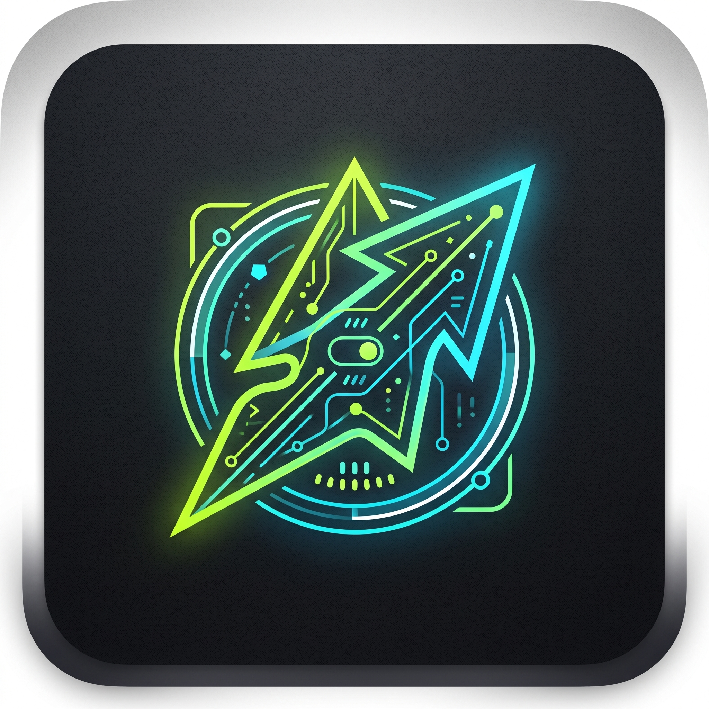

<p align="center">
  
</p>

<h1 align="center">DarkIO<code>_</code></h1>

<p align="center">
  En tommelfinger-først hjemskærm til Android.<br>
  Mørk og teknisk som en terminal, med lidt leg i farverne.
</p>

---

DarkIO er en personlig launcher til en Pixel 10 med Android 16, bygget i Kotlin og Jetpack Compose. Den erstatter telefonens hjemskærm med tre sider, en app-skuffe og et dashboard, der viser det, jeg faktisk bruger i løbet af dagen.

> **Status:** under udvikling. Version 1 bygges ét [issue](https://github.com/Zpolonius/DarkIO/issues) ad gangen.

## Hvad den kan (v1)

| | |
|---|---|
| **Tre sider** | *i dag* (ur, næste aftale, fokus, dagens tip), *træning* (dagens pas, ugen, skridt, forbrændt) og *byg* (dagens vibe-coding-tip og tidligere tips) |
| **Fast dock** | 4 favoritter og søgefeltet står samme sted på alle sider; over docken skifter 4 genveje med siden |
| **App-skuffe** | Gitter med rigtige app-ikoner, kategorier i en bundbar, søgning nederst og skjulte apps |
| **Dashboard** | Kalender, fokus (skærmtid og oplåsninger), skridt og forbrændte kalorier fra Health Connect, dagens træning |
| **Skrivemaskine-effekt** | Dagens tip skrives frem tegn for tegn; tryk springer over, og den slås fra med "Fjern animationer" |
| **Din egen baggrund** | Telefonens baggrund vises bag hjemskærmen med en toning, så tekst altid kan læses |

## Principper

- **Kig øverst, tryk nederst.** Øverste halvdel af skærmen er kun til at kigge på. Alt du trykker på dagligt ligger inden for tommelfingerens rækkevidde.
- **Intet forlader telefonen.** DarkIO har ingen internetadgang. Kalender-, sundheds- og brugsdata læses lokalt og gemmes ikke.
- **Ingen baggrundsarbejde.** Kortene opdateres kun, når hjemskærmen vises.
- **Minimal kode.** Få afhængigheder, ingen abstraktioner før de bruges to steder.

## Tilladelser

Hver tilladelse spørges først, når det kort, der bruger den, slås til.

| Tilladelse | Bruges til |
|---|---|
| Kalender | Næste aftale |
| Adgang til brugsdata | Skærmtid og antal oplåsninger |
| Health Connect: skridt, forbrændte kalorier | Skridt- og forbrændt-kort |
| Udvid statuslinje | Swipe ned åbner notifikationer |
| Anmod om afinstallation | "Afinstallér" i app-menuen (Android beder altid selv om bekræftelse) |

DarkIO beder **ikke** om internet eller om at se alle installerede pakker.

## Kom i gang

**Du skal bruge:** Android Studio med JDK 17 og Android SDK 37, en telefon eller emulator med Android 15 eller nyere.

```bash
git clone https://github.com/Zpolonius/DarkIO.git
cd DarkIO
./gradlew assembleDebug        # Windows/PowerShell: .\gradlew.bat assembleDebug
./gradlew installDebug
```

Tryk derefter på Hjem-knappen og vælg DarkIO, eller gå til **Indstillinger → Apps → Standardapps → Startskærm**. Din gamle launcher røres ikke og kan vælges igen samme sted.

### Kommandoer

| Opgave | Kommando |
|---|---|
| Byg | `./gradlew -q --console=plain assembleDebug` |
| Unit-tests | `./gradlew -q --console=plain testDebugUnitTest` |
| UI-tests (emulator kører) | `./gradlew -q --console=plain connectedDebugAndroidTest` |
| Lint | `./gradlew -q --console=plain lintDebug` |
| Release med R8 | `./gradlew -q --console=plain assembleRelease` |

## Projektet

```
app/src/main/java/app/darkio/
├── MainActivity.kt
├── data/          LauncherApps, Room, DataStore, Health Connect
├── home/          de tre sider, dock og genveje
├── drawer/        app-skuffe, kategorier, søgning
├── dashboard/     kortene
├── settings/      indstillinger
└── ui/theme/      DarkIOColors, DarkIOType, DarkIOShapes …
docs/
├── DarkIO – kravspecifikation v1.md   krav F1–F21 og N1–N11
├── design-system.md                   farver, typografi, regler
├── tokens.json                        designets værdier
└── brand/                             logo
```

**Designet** styres fra [`docs/tokens.json`](docs/tokens.json). Skærmkode bruger altid `DarkIOColors`, `DarkIOType` og `DarkIOShapes`, og `TokensTest` fejler, hvis koden og tokens glider fra hinanden. Læs [`docs/design-system.md`](docs/design-system.md) for reglerne, fx om tommelfinger-zonen, skrivemaskine-effekten og baggrunden.

## Sådan bygges den

Hvert issue løses i sin egen pull request med et *udvikler → tester → integrator*-loop:

1. En udvikler-agent skriver først en test, der fejler, og derefter koden.
2. En tester-agent med en anden model gennemgår ændringen og finder fejl.
3. Et sluttjek kontrollerer sikkerhed, UI/UX og QA, inklusive både nye og eksisterende brugere, før PR'en åbnes.

Issues har labelen `loop:small` (ren UI og tekst, uden tester) eller `loop:full` (data, tilstand og tilladelser). Regler for kode og tests står i [`CLAUDE.md`](CLAUDE.md).

## Licenser

Fontene [Space Grotesk](licenses/SpaceGrotesk-OFL.txt) og [JetBrains Mono](licenses/JetBrainsMono-OFL.txt) er under SIL Open Font License og ligger i appen, så de ikke hentes over nettet. Projektet har endnu ikke valgt en licens for selve koden.
